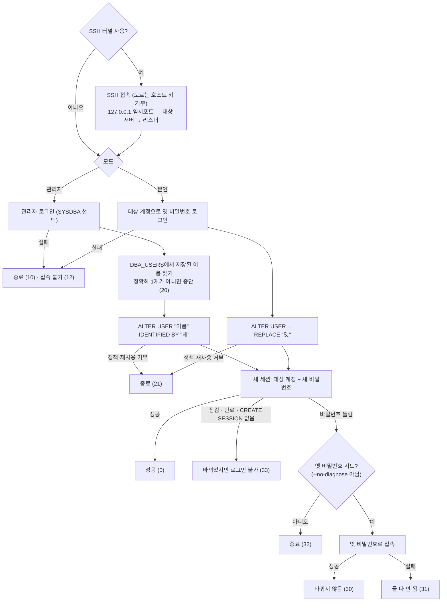

# oracle-password-rotate

Oracle DB 계정의 비밀번호를 바꾸고, **그 계정으로 새 비밀번호 접속이 되는지까지 확인**하는 도구입니다. DB 리스너가 서버 안(127.0.0.1)에서만 열려 있으면 SSH 터널로 접속합니다.

실습에서 비밀번호 관리 솔루션의 Oracle 연동 스크립트에 SSH 터널 접속 기능을 추가해 테스트했습니다. 같은 시기에 "변경은 성공인데 계정이 잠긴다"는 문제도 겪었습니다. 이 레포는 그때 알게 된 것을 바탕으로 **처음부터 새로 쓴 일반 도구**입니다. 제품 스크립트의 코드, 인자 형식, 결과 형식은 들어 있지 않습니다.

```text
15:45:34 start: app_svc on 127.0.0.1:1521/APPPDB
15:45:34 admin sign-in: ok (SYSTEM)
15:45:34 account 'app_svc' is stored as 'APP_SVC'
15:45:34 ALTER USER APP_SVC: ok
FAIL 33: password changed, but APP_SVC cannot sign in: account is locked (ORA-28000)
```

`ALTER USER`는 성공했지만 계정이 잠겨 있어 새 비밀번호로도 접속할 수 없는 경우입니다. 변경만 확인하는 스크립트라면 여기서 "성공"으로 끝납니다. 위 출력은 테스트용 가짜 DB(`tests/fake_db.py`)로 실행한 결과입니다. 진짜 Oracle 21c에서도 같은 경우를 CI가 확인합니다.

## 흐름



## 구성

| 파일 | 하는 일 |
|---|---|
| `names.py` | 계정 이름 후보 만들기, 식별자 따옴표 처리, 비밀번호 검사, `ALTER USER` 문 만들기 |
| `db.py` | oracledb(thin 모드)를 쓰는 유일한 파일. 오류를 `ORA-`/`DPY-` 코드로 정리 |
| `tunnel.py` | SSH 로컬 포트 포워딩. 이 PC의 127.0.0.1에만 열림 |
| `flow.py` | 로그인 → 이름 확인 → 변경 → 새 세션으로 확인 → 실패 원인 구분 |
| `cli.py` | 인자와 환경변수 처리. 진행 로그는 stderr, 결과 한 줄은 stdout, 원인은 종료코드 |

| 코드 | 뜻 |
|---|---|
| `0` | 바꿨고, 그 계정으로 새 비밀번호 접속까지 됨 |
| `2` | 인자 오류 (DB에 접속하기 전에 멈춤) |
| `10` | 관리자 로그인 실패 (본인 모드에서는 옛 비밀번호 로그인 실패) |
| `12` | DB에 닿지 못함: 리스너, 서비스 이름, 네트워크, SSH 터널 |
| `20` | 계정이 없거나, 이름이 여러 계정에 해당함 |
| `21` | DB가 비밀번호를 거부함: 검증 함수(ORA-28003), 재사용 금지(ORA-28007), 옛 비밀번호 틀림(ORA-28008). 큰따옴표가 든 비밀번호는 접속 전에 거부 |
| `22` | 권한 없음 |
| `23` | 그 밖의 `ALTER USER` 실패 |
| `30` | 바뀌지 않음: 옛 비밀번호로 아직 접속됨 |
| `31` | 새 비밀번호도 옛 비밀번호도 안 됨 |
| `32` | 새 비밀번호로 안 됨. 옛 비밀번호는 일부러 시도하지 않음 |
| `33` | 비밀번호는 바뀌었지만 DB가 로그인을 막음: 잠김(ORA-28000), 만료(ORA-28001), CREATE SESSION 없음(ORA-01045) |
| `41` | 시간 초과 |

## 설계 판단

**"변경 성공"과 "로그인 가능"을 따로 봅니다.** 관리자가 실행하는 `ALTER USER`는 계정이 잠겨 있어도 성공합니다. 실습에서 변경은 매번 성공으로 나오는데 계정이 몇 분 만에 다시 잠기는 일을 겪었습니다. 원인은 그 계정을 쓰는 애플리케이션이 옛 비밀번호로 계속 재접속한 것이었습니다. 그래서 바꾼 뒤 그 계정으로 새 세션을 열어 봅니다. 잠김, 만료, 접속 권한 없음은 "비밀번호 틀림"과 다른 코드(33)로 알립니다. 도구는 잠금을 풀지 않습니다. 왜 잠겼는지 사람이 확인해야 하기 때문입니다.

**계정 이름을 SQL에 그대로 이어 붙이지 않습니다.** `ALTER USER` 같은 DDL에는 바인드 변수를 쓸 수 없어서 문장을 문자열로 만들어야 합니다. 그래서 입력받은 이름으로 `DBA_USERS`를 먼저 조회합니다(이 조회는 바인드 변수 사용). 찾은 이름은 큰따옴표 식별자로 감쌉니다. `scott`이 `SCOTT`과 `"scott"` 둘 다에 해당하면 추측하지 않고 멈춥니다. 이름에 `APP_SVC ACCOUNT UNLOCK` 같은 절을 끼워 넣어도 그런 계정은 없으므로 아무것도 실행되지 않습니다. 테스트가 이 경우를 확인합니다.

**비밀번호가 문장을 깨뜨리지 못하게 미리 거릅니다.** 비밀번호는 큰따옴표 안에 들어갑니다. 큰따옴표, 줄바꿈, 제어문자가 있으면 접속하기 전에 거부합니다. Oracle 비밀번호에는 원래 큰따옴표를 쓸 수 없습니다. 변경 문장은 로그에 쓰지 않습니다. 오류가 나도 traceback을 출력하지 않습니다. traceback에 문장 내용이 남을 수 있기 때문입니다.

**숨은 설정을 쓰지 않습니다.** 멀티테넌트(CDB/PDB) 환경에서 계정 이름 규칙을 피하려고 `_ORACLE_SCRIPT` 같은 숨은 파라미터를 켜는 방법이 있습니다. 이 파라미터는 Oracle 내부 스크립트용이라 쓰지 않습니다. 대신 SID가 아니라 PDB 서비스 이름으로 접속합니다.

**옛 비밀번호 시도는 끌 수 있습니다.** 새 비밀번호로 안 되면 옛 비밀번호로 한 번 더 접속해 "안 바뀜"(30)과 "둘 다 안 됨"(31)을 나눕니다. 그런데 틀린 접속은 `FAILED_LOGIN_ATTEMPTS`에 한 번씩 쌓입니다. 이미 실패가 쌓인 계정이라면 이 한 번에 잠길 수 있습니다. 그래서 `--no-diagnose`로 끌 수 있게 했습니다. 테스트는 이 옵션을 켜면 실패 횟수가 하나만 쌓이는지 확인합니다.

**SSH 터널은 포트 22만 씁니다.** 보안 정책상 리스너가 127.0.0.1에서만 열려 있는 서버가 있습니다. 이런 서버는 SSH로 접속한 뒤 서버 안쪽의 리스너로 연결을 이어 줍니다. 이 PC 쪽 임시 포트는 127.0.0.1에만 열립니다. 처음 보는 SSH 호스트 키는 받아들이지 않습니다.

**Oracle 21c + SSH 터널의 ORA-12569는 재현되지 않았습니다.** 실습에서는 Oracle 21c에 SSH 터널로 접속할 때 ORA-12569가 났고, 원인을 찾지 못했습니다. 그때 세운 가설은 Oracle Net의 OOB(대역 외 신호)였습니다. OOB는 TCP 긴급 데이터를 쓰는데, SSH 포워딩은 바이트만 전달하고 긴급 표시는 넘기지 않는다는 생각이었습니다. 이 도구에는 OOB를 끄는 `--disable-oob`를 넣었습니다. 그런데 CI에서 Oracle XE 21c에 터널로 접속하는 테스트는 OOB를 켠 상태와 끈 상태 **모두 통과**했습니다. 실습 스크립트는 Oracle Client를 쓰는 드라이버(cx_Oracle)였고, 이 도구는 Client 없이 동작하는 python-oracledb thin 모드입니다. 이 차이 때문일 수 있지만 확인하지는 않았습니다. 그래서 가설은 아직 가설로 둡니다.

## 쓰는 법

```bash
pip install .
```

관리자 모드:

```bash
oracle-password-rotate --host db.example.test --service APPPDB --account APP_SVC --admin-user SYSTEM --admin-password-env ADMIN_PW --new-password-env NEW_PW --old-password-env OLD_PW
```

본인 모드: 관리자 없이, 그 계정이 자기 비밀번호를 바꿉니다(`REPLACE` 절을 붙임).

```bash
oracle-password-rotate --host db.example.test --service APPPDB --account APP_SVC --new-password-env NEW_PW --old-password-env OLD_PW
```

SSH 터널: `--host`는 SSH 서버에서 본 DB 주소입니다.

```bash
oracle-password-rotate --host 127.0.0.1 --service APPPDB --account APP_SVC --admin-user SYSTEM --admin-password-env ADMIN_PW --new-password-env NEW_PW --ssh-tunnel ops@db.example.test --ssh-key ~/.ssh/id_ed25519
```

비밀번호는 환경변수로만 받습니다. 명령 인자는 `ps`로 누구나 볼 수 있기 때문입니다. Oracle Client는 설치하지 않아도 됩니다.

## 테스트

```bash
pip install -e ".[test]"
pytest -v tests/test_flow.py     # DB 없이: 판정 로직과 문장 만들기 (tests/fake_db.py)
```

| 경우 | 기대 |
|---|---|
| 관리자 모드 정상 | `0`, 보낸 문장은 `ALTER USER "APP_SVC" IDENTIFIED BY "..."` 하나 |
| 소문자 이름 `app_svc` | `APP_SVC`를 찾아 `0` |
| `scott`과 `"scott"`이 둘 다 있음 | `20`, 아무것도 실행 안 함 |
| 이름에 SQL 절을 끼워 넣음 | `20`, 아무것도 실행 안 함 |
| 큰따옴표·줄바꿈이 든 비밀번호 | 접속 전에 `21` |
| 검증 함수 거부 / 재사용 | `21` (ORA-28003 / ORA-28007) |
| **잠긴 계정** | 비밀번호는 바뀌고 `33` (ORA-28000) |
| CREATE SESSION 없음 | `33` (ORA-01045) |
| 문장은 실행됐지만 안 바뀜 | `30` |
| 같은 경우 + `--no-diagnose` | `32`, 실패 횟수 1회만 쌓임 |
| 본인 모드 | `REPLACE` 절이 붙고 `0` |
| 모든 경우 | 출력에 비밀번호 없음 |

`tests/test_oracle.py`는 진짜 Oracle을 상대로 돌립니다. CI(GitHub Actions)는 Oracle XE 21c 컨테이너와 sshd를 띄웁니다. 테스트용 검증 함수와 프로파일(최소 12자, 재사용 금지, 3회 실패 시 잠금)을 만든 뒤 다음을 확인합니다.

- 관리자 모드, SYSDBA 모드, 본인 모드(`REPLACE`)
- 검증 함수 거부, 재사용 거부
- 잠긴 계정 (잠금을 풀지 않는지까지), CREATE SESSION 없음
- 없는 계정, 없는 서비스 이름
- 본인 모드에서 옛 비밀번호를 세 번 틀리면 잠김
- SSH 터널 (OOB 켬 / 끔)

DB 없는 테스트는 Windows와 Ubuntu에서 돌립니다.

## 실습 스크립트와 다른 점

- 인자 순서와 결과 출력 형식은 제품 규약을 따르지 않고 새로 정했습니다
- cx_Oracle(Oracle Client 필요) 대신 python-oracledb thin 모드를 씁니다
- 새로 넣은 것: 새 세션으로 접속 확인, 원인별 종료코드, `DBA_USERS` 조회와 식별자 따옴표 처리, 비밀번호 사전 검사, 본인 모드 `REPLACE`, 모르는 SSH 호스트 키 거부, `--disable-oob`
- 실습 환경의 주소, 계정, 버전 정보는 들어 있지 않습니다

## 만든 방식

실습에서 직접 겪은 문제(잠기는 서비스 계정, 내부 전용 리스너, 21c 터널 오류)를 바탕으로 구조를 잡았고, 코드는 Claude Code로 작성했습니다.
